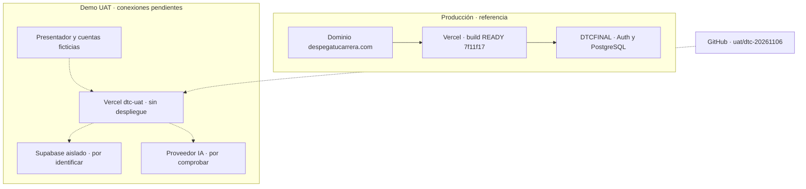
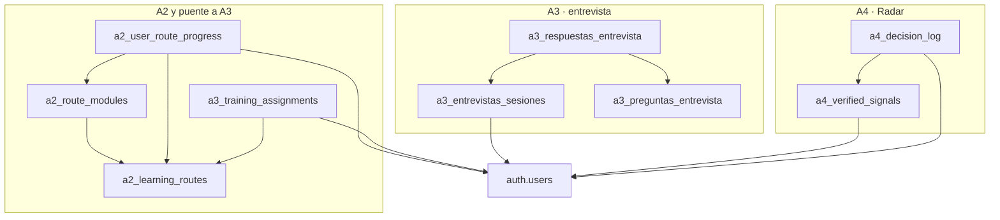
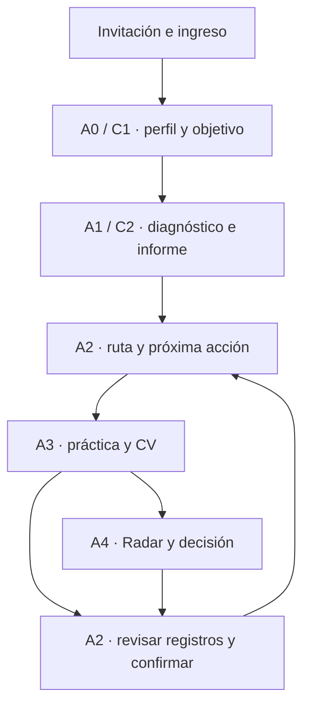

# DespegaTuCarrera · Arquitectura y preparación de la demo

Revisión del 26 de noviembre de 2026. Rama `uat/dtc-20261106` en `jcv86/main`. Referencia de código para AG05 `22d533d`, con evidencia registrada en `124537c`.

**Estado de entrega.** La versión nueva de UAT todavía carece de una URL navegable. La [aceptación de negocio](DTC_UAT_ACCEPTANCE_20261106.md) corresponde a `7eb0544` y a su alcance de Auth/C1. La [evidencia de AG05](DTC_A2_REVIEW_EVIDENCE_20261106.md) acredita en laboratorio 4 comprobaciones SQL y 15 pasos de navegador sobre el candidato posterior. Los 48 casos base y 6 condicionales manuales siguen registrados como no ejecutados.

## Ambientes y conexiones

Las líneas discontinuas marcan conexiones pendientes de configuración o verificación. El proyecto de UAT tiene protección Vercel SSO y solo registra `DTC_ENVIRONMENT`. El despliegue Git automático de esa rama está deshabilitado en [vercel.json](../../vercel.json). El intento anterior de Preview, en el proyecto productivo y sobre `367c573`, figura ERROR. El último build productivo READY observado corresponde a `7f11f17`, con [registro de despliegue](https://vercel.com/despega-tu-carrera/v0-fork-of-despega-tu-carrera-clone/CYMMTZc1qcUjsWnzvyXCt7LbopJM). La preparación de la demo requiere su propia URL y la comprobación de su SHA exacto.

## Base de datos

El catálogo remoto de DTCFINAL devolvió 381 tablas públicas, todas con RLS habilitado. El siguiente diagrama muestra claves foráneas observadas en una selección de 156 tablas de la plataforma. La flecha va de hija a padre. La verificación de permisos efectivos por usuario en la demo queda en la prueba de aceptación.

| Dominio | Persistencia o contrato comprobado | Verificación pendiente en el destino UAT |
| --- | --- | --- |
| Identidad | Supabase Auth y admisión por `resolve_pilot_access`. Hay FKs a `auth.users` y a `public.users` en distintas tablas del catálogo. | Alta e ingreso de cuentas ficticias, regreso, sesión vencida, salida y aislamiento entre dos usuarios. |
| A0 / C1 | `assessment_drafts`, `canon_conozcamonos_1_responses`, `despega_user_profiles` y recibo privado en la migración C1. | Probar borrador, reintento y escritura atómica en las cuatro relaciones. |
| A1 / C2 | Diagnóstico, interpretación e informe con contexto C1/C2 según el registro de cierre. | Guardar, retomar, generar informe y entrar a A2 con el contexto correcto. Verificar nivel gratuito/pago si forma parte de la demo. |
| A2 | Rutas y progreso en catálogo. La migración del plan incorpora `a2_reviewed_plans`, `dtc_private.a2_plan_revisions` y `dtc_private.a2_plan_receipts`. | Activar por confirmación, revisar tras recarga y probar `HECHO`, `NO PUDE` y `CAMBIAR` según su contrato. |
| A3 | Sesiones, respuestas, preguntas y `dtc_documents` con referencias a propietario y documento anterior. | Una simulación con feedback persistido y una edición de CV/ATS que se pueda volver a abrir. |
| A4 | Oportunidades, señales y decisiones. A2 lee los registros aplicables de A3/A4 desde `GET /api/a2/plan`. | Mostrar oportunidad con origen y fecha, guardar decisión y comprobar que A2 muestra el insumo conservando el borrador. |

### Cambios de esquema requeridos por el candidato

- [20261106173017_c1_atomic_completion.sql](../../supabase/migrations/20261106173017_c1_atomic_completion.sql) agrega el cierre C1 y la consulta de estado. La consulta de catálogo del 26/11 confirmó que DTCFINAL tiene `assessment_drafts` y `resolve_pilot_access`, y carece de `dtc_private`, `complete_c1_atomic` y `get_c1_completion_status`.
- `20261106201731_a2_reviewed_plan_atomic.sql` incorpora el plan revisado, su historial y recibos. Su alcance está en el [cierre AG03](DTC_A2_REVIEWED_PLAN_20261106.md).
- [20261106221437_a2_assistant_action_receipts.sql](../../supabase/migrations/20261106221437_a2_assistant_action_receipts.sql) depende del helper de admisión de AG03 y de `dtc_documents`. El [cierre AG04](DTC_A2_REVIEWED_ACTIONS_20261106.md) identifica la dependencia de esa tabla existente. Comprobar el esquema base, extensiones y dependencias en una inicialización limpia antes de aplicar la cadena de migraciones del candidato.
- Cargar únicamente datos sintéticos o material de catálogo autorizado para la demo. Registrar en el destino el historial aplicado y las comprobaciones de RPC, RLS, permisos y rollback.

## Flujo para presentar

1. Entrar con una cuenta ficticia desde la URL UAT. Guardar y retomar C1, y abrir el informe A1.
2. En Tu Ruta, mostrar la próxima acción y confirmar un plan. Recargar y comprobar que se mantiene.
3. Mostrar una práctica A3, una edición de CV y una oportunidad A4 con fecha y origen. Guardar una decisión y volver al plan.
4. Desde «Antes de seguir», mostrar la evidencia disponible de A3/A4 y confirmar explícitamente cualquier ajuste. La prueba de un proveedor real y la evaluación con participantes siguen abiertas. Mantener el canary apagado mientras se comprueba el recorrido base.

## Orden de cierre

| Orden | Trabajo | Evidencia exigida |
| --- | --- | --- |
| 1 | Identificar o provisionar el Supabase UAT dedicado. | Ref explícitamente asociado a DTC UAT y separado de DTCFINAL. |
| 2 | Preparar esquema base, migraciones y cuentas ficticias. | Aplicación reproducible en limpio, catálogo y permisos comprobados, rollback ensayado en UAT. |
| 3 | Configurar `dtc-uat` y publicar en forma controlada desde el SHA elegido. | URL protegida READY, SHA exacto, backend UAT confirmado y cuenta de presentación con acceso. |
| 4 | Ejecutar el recorrido anterior, escritorio y móvil, con dos cuentas. | Evidencia de cada transición, recarga, aislamiento, sesión y recuperación. Registrar resultados por caso en la matriz. |
| 5 | Verificar integraciones que se mostrarán. | Proveedor IA real o demo identificada con datos preparados. Validar catálogo vigente o declarar su fecha. Comprobar pago en sandbox solo si se va a presentar. |
| 6 | Ensayar y cerrar el alcance con el responsable. | Enlace, guion, credenciales entregadas por canal seguro y decisión sobre los casos manuales pendientes. |

Según [environment.ts](../../lib/uat/environment.ts), el build hospedado requiere `DTC_ENVIRONMENT=uat`, `DTC_UAT_SUPABASE_REF`, `NEXT_PUBLIC_SUPABASE_URL`, `NEXT_PUBLIC_SUPABASE_ANON_KEY`, `SUPABASE_SERVICE_ROLE_KEY` y `NEXT_PUBLIC_APP_URL`. Si se configuran URL alternativas de sitio o Auth, deben coincidir con el origen UAT. La clave de servicio queda en servidor. UAT excluye conexiones PostgreSQL directas heredadas, aliases públicos de secretos y Resend. Las llamadas a cron, emails y contacto están deshabilitadas allí.

Fuentes de continuidad: [registro de cierre](DTC_CLOSURE_LEDGER.md), [cierre de Auth/C1](DTC_AUTH_C1_CLOSURE_20261106.md), [contrato C1](DTC_C1_COMPLETION_API_20261106.md) y [coordinación asistida](DTC_AGENTIC_COORDINATION_20261106.md).
